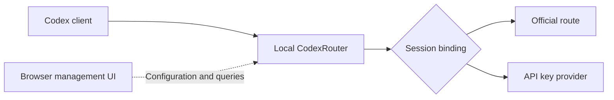

<div align="center">


# CodexRouter

**Manage multiple Codex providers while keeping every session on its own route.**

Local Windows router · Session bindings · Usage and latency · System tray

[中文](README.md) · [English](README.en.md)

[](https://github.com/schneelolz/CodexRouter/actions/workflows/ci.yml) [](docs/ui-layout.md) [](#quick-start) [](go.mod) [](frontend/package.json) [](LICENSE)

[Quick start](#quick-start) · [Features](#features) · [User guide](docs/quick-start.md) · [Development](docs/handoff.md)

</div>

## Overview

CodexRouter runs locally on Windows, with a Go backend and a separate Vue 3 / TypeScript management UI. Configure the official route and multiple API key providers in one place, choose a default for new sessions, and inspect request results, tokens, cache usage, time to first token, and output rate.

Routing is bound to each session: **changing the default only affects new sessions.** Existing sessions keep their original provider. Historical sessions with an unknown origin wait for you to register their original provider before retrying from the client.



## Features

| Capability | What it provides |
|---|---|
| Provider management | Names, complete base URLs, separate API keys, and optional model overrides; official client credentials stay separate from provider keys |
| Session routing | A default provider for new sessions, persistent existing bindings, and registration for sessions with an unknown origin |
| Requests and usage | Separate usage, error, processing, and unconfirmed views; input, output, cached, and reasoning token details |
| Latency and throughput | Time to first token, total duration, output TPS, and two independently colored latency indicators |
| History management | Backend pagination, retention policies, and confirmed cleanup without removing session bindings |
| Daily client integration | Preview and apply the Codex connection address, preserve existing login/history/project directories, and restore the original connection value |
| System tray | Launch the service and browser UI, keep running after the browser closes, and reopen the existing instance on repeated launch |

The UI has grouped request and session menus, compact tables, and scrolling limited to the relevant data area. Missing metrics are distinguished from actual zero values, and generation failures returned inside HTTP 200 responses are classified as errors. See [UI and metrics](docs/ui-layout.md).

## Quick start

### 1. Build

Building requires **Windows x64, PowerShell 7, Go 1.27.3, and Node.js 24**. No GitHub Release has been published yet; build from source:

```powershell
git clone https://github.com/schneelolz/CodexRouter.git
cd CodexRouter
.\scripts\build.ps1 -OutputDir artifacts\build-local -Version 0.8.0-test-compact-ui1
```

Keep `codexrouter.exe` and its adjacent `ui/` directory together. The built application runs without Go, Node.js, or Python installed. Supply the version label explicitly with `-Version`.

### 2. Start and configure a provider

For an initial trial, use a separate data directory and an available port:

```powershell
.\artifacts\build-local\codexrouter.exe launch `
  --data-dir .\runtime\trial --port 19973
```

For daily use, double-click `codexrouter.exe`. The default address is `http://127.0.0.1:18788` and the default data directory is `%APPDATA%\CodexRouter`. Closing the browser leaves the service running; use the tray menu to exit.

Under **供应商设置** (Provider settings), enter a provider name, full base URL, API key, and optional model. Then select the default for new sessions under **线路总览** (Route overview). `/v1` is not added automatically. The official route uses the client's own official credentials.

### 3. Connect Codex

Open **客户端与接入 → 日常使用** (Clients and integration → Daily use), preview the connection address change, and confirm it. Save your work, close Codex, and reopen it from its normal entry point. Check new requests under **请求管理 → 请求明细** (Request management → Request details).

For sessions with an unknown origin, select their original provider under **会话管理 → 待登记会话** (Session management → Pending sessions), confirm it, and retry from the client. Existing bindings appear under **已绑定会话** (Bound sessions).

To revert, use **恢复接入前配置** (Restore previous connection) on the Daily use page, confirm, and reopen the client. See the [user guide](docs/quick-start.md) for detailed steps and troubleshooting. The application UI and supporting documents are currently in Chinese.

## Project status

The current source baseline is the **0.8 candidate**, with management API **1.8** and SQLite history schema **3**. It is intended for development and controlled trials. See the [acceptance matrix](docs/acceptance-matrix.md) for detailed scope.

| Area | Status |
|---|---|
| Windows builds, Go tests and race detection, standalone startup checks | Included in GitHub CI |
| Contracts, frontend types, unit tests, three-viewport browser regression, and Go API integration | Included in GitHub CI with synthetic data |
| Real official/API key upstreams and authenticated desktop generation on this candidate | Awaiting real-world validation |
| Subagents, separate thread/session identities, and actual desktop side chats | Known compatibility limits; full support is not established |

The router forwards HTTP/SSE. It does not implement WebSocket forwarding, automatic cross-provider failover, automatic replay of generation requests, or billing. A successful model-list request does not establish generation compatibility.

## Data and updates

- Provider keys and management control credentials use Windows Credential Manager. Configuration and session bindings live in `state.json`; request history lives in `history.sqlite`.
- History stores metadata such as model, session ID, usage, and timing, without chat bodies or authentication. Keep API keys, management bootstrap links, cookies, and runtime data private.
- Daily integration changes only the original connection field. Restore records live in the original directory's `.codexrouter-routing` folder. Exiting the router does not restore direct access automatically; confirm restoration in the UI and restart the client.
- Before updating, stop the target instance normally and back up its entire data directory. Do not copy or delete individual SQLite sidecar files while it is running. Rolling back requires the matching pre-upgrade data backup; copying a directory does not migrate system credentials.

## Development and checks

```powershell
# Contracts, backend, and frontend checks
node scripts/contract-check.mjs
go test ./cmd/... ./internal/... -count=1 -timeout 180s
npm --prefix frontend ci
npm --prefix frontend run typecheck
npm --prefix frontend run test

# Synthetic management UI
npm --prefix frontend run dev:mock
```

[GitHub Actions CI](https://github.com/schneelolz/CodexRouter/actions/workflows/ci.yml) runs backend tests, race detection, builds, startup checks, and frontend browser/API integration on pushes and pull requests. Full local verification uses `.\scripts\verify.ps1 -InstallBrowser`. See [development notes](docs/handoff.md) for the Windows race toolchain and local integration options.

## Documentation

Supporting documents are currently in Chinese.

| Document | Contents |
|---|---|
| [User guide](docs/quick-start.md) | Startup, connection, restoration, and updates |
| [UI and metrics](docs/ui-layout.md) | Navigation, usage semantics, latency thresholds, and classification |
| [Protocol and routing](docs/protocol.md) | Session identity, fixed bindings, and forwarding boundaries |
| [Management API](contracts/README.md) / [OpenAPI](contracts/openapi.json) | Interfaces, types, and compatibility |
| [Development](docs/handoff.md) / [Verification](docs/verification.md) | Toolchain, test entry points, and evidence |
| [Acceptance matrix](docs/acceptance-matrix.md) | Verified scope and known limitations |
| [Publication and privacy](docs/publication.md) | Published source scope and handling of sensitive material |

## License

CodexRouter is licensed under [AGPL-3.0-only](LICENSE). See [NOTICE](NOTICE) for copyright and third-party notices. Dependency licenses are preserved in `docs/` and retain their own terms.
