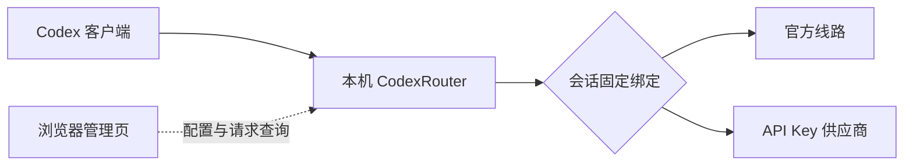

<div align="center">


# CodexRouter

**为 Codex 管理多家供应商，让每个会话保持自己的线路。**

Windows 本机路由 · 会话固定绑定 · 请求用量与延迟 · 托盘管理

[中文](README.md) · [English](README.en.md)

[](https://github.com/schneelolz/CodexRouter/actions/workflows/ci.yml) [](docs/ui-layout.md) [](#快速开始) [](go.mod) [](frontend/package.json) [](LICENSE)

[快速开始](#快速开始) · [核心功能](#核心功能) · [使用说明](docs/quick-start.md) · [开发文档](docs/handoff.md)

</div>

## 项目简介

CodexRouter 是运行在 Windows 本机的 Codex 请求路由器，使用 Go 后端和独立的 Vue 3 / TypeScript 管理页面。你可以集中配置官方线路和多家 API Key 供应商，为新会话选择默认线路，并查看请求结果、Token、缓存、首字时间和输出速率。

它以会话为单位固定供应商：**切换默认线路，只影响后续新会话。** 已有会话继续使用原供应商；来源无法确认的历史会话，会先等待你登记原供应商，再由客户端重试。



## 核心功能

| 能力 | 你可以做什么 |
|---|---|
| 多供应商管理 | 保存名称、完整 Base URL、独立 API Key 和可选模型覆盖；官方身份与中转密钥分开处理 |
| 会话固定线路 | 选择新会话的默认供应商，查询已有绑定，为未知历史登记原供应商 |
| 请求与用量 | 分别查看用量明细、错误、处理中和待确认请求；查看输入、输出、缓存、推理及精确明细 |
| 延迟与速率 | 查看首字、总耗时和 TPS；双色柱分别表示首字与总耗时的健康分档 |
| 历史管理 | 后端分页查询、设置保留天数、确认清理；清理请求记录不会删除会话绑定 |
| 日常接入与恢复 | 预览并确认 Codex 连接地址变更，保留原登录、历史和项目目录，支持恢复原连接值 |
| 本机托盘 | 双击启动并打开管理页，关闭网页后继续运行；重复启动尝试唤起已有实例 |

管理界面采用“请求管理 / 会话管理”两级菜单、紧凑表格和独立数据滚动区。指标缺失与真实零值分开显示，HTTP 200 中的生成失败也会归入错误。详见[页面与指标说明](docs/ui-layout.md)。

## 快速开始

### 1. 构建程序

构建需要 **Windows x64、PowerShell 7、Go 1.27.3、Node.js 24**。目前尚未发布 GitHub Release，可从源码构建：

```powershell
git clone https://github.com/schneelolz/CodexRouter.git
cd CodexRouter
.\scripts\build.ps1 -OutputDir artifacts\build-local -Version 0.8.0-test-compact-ui1
```

产物包含 `codexrouter.exe` 和相邻的 `ui/` 目录，请一起保留。构建后的程序无需安装 Go、Node.js 或 Python。版本标签由 `-Version` 显式指定。

### 2. 启动并配置线路

首次试用建议使用独立数据目录和空闲端口：

```powershell
.\artifacts\build-local\codexrouter.exe launch `
  --data-dir .\runtime\trial --port 19973
```

日常使用也可直接双击 `codexrouter.exe`：默认地址为 `http://127.0.0.1:18788`，数据目录为 `%APPDATA%\CodexRouter`。关闭浏览器后服务继续运行，需要退出时使用托盘菜单。

在**供应商设置**中填写中转供应商的名称、完整 Base URL、API Key 和可选模型，再到**线路总览**选择新会话的默认供应商。Base URL 不自动补 `/v1`；官方线路沿用客户端自身的官方身份。

### 3. 接入 Codex

打开 **客户端与接入 → 日常使用**，预览并确认连接地址变更。保存工作后，手动退出并从原入口重新打开 Codex，然后到 **请求管理 → 请求明细** 核对新请求。

未知历史会话在 **会话管理 → 待登记会话** 选择原供应商，确认后回到客户端重试。已有绑定可在 **已绑定会话** 查询。

需要恢复时，在日常使用页面选择**恢复接入前配置**，确认后重新打开客户端。完整操作和排障见[快速开始手册](docs/quick-start.md)。

## 当前状态

当前为 **0.8 候选版**，管理 API **1.8**，请求历史 SQLite schema **3**。适合开发验证与受控试用，实际支持范围见[验收状态](docs/acceptance-matrix.md)。

| 范围 | 当前状态 |
|---|---|
| Windows 构建、Go 普通 / race 测试、独立启动检查 | 已纳入 GitHub CI |
| 契约、前端类型、单测、三视口浏览器回归及 Go API 联调 | 已纳入 GitHub CI，使用合成数据 |
| 当前候选的真实官方 / API Key 上游、已登录桌面生成 | 尚待真实链路验收 |
| 子代理、thread/session 分离、真实侧边聊天 | 存在已知兼容性限制，不能视为完整支持 |

当前提供 HTTP/SSE 转发，不实现 WebSocket、跨供应商自动切换、生成请求自动重放或金额计费。模型列表能够拉取，也不代表该供应商的生成接口已经验证通过。

## 数据与更新

- 供应商密钥和管理控制凭据保存在 Windows Credential Manager；配置与会话绑定在 `state.json`，请求历史在 `history.sqlite`。
- 请求历史保存模型、会话标识、用量和时间等元数据，不保存聊天正文或认证。API Key、管理入口令牌、Cookie 和运行数据均应保持私密。
- 日常接入只修改原配置的连接字段；恢复依据在原目录的 `.codexrouter-routing`。退出路由器不会自动恢复直连，需要在管理页确认恢复并重开客户端。
- 更新前正常停止目标实例，整体备份数据目录。不要单独复制或删除运行中的 SQLite 附属文件；回退旧版程序时须使用配套的升级前数据副本。复制目录不会迁移系统凭据。

## 开发与验证

```powershell
# 契约、后端与前端基础检查
node scripts/contract-check.mjs
go test ./cmd/... ./internal/... -count=1 -timeout 180s
npm --prefix frontend ci
npm --prefix frontend run typecheck
npm --prefix frontend run test

# 启动合成管理页面
npm --prefix frontend run dev:mock
```

[GitHub Actions CI](https://github.com/schneelolz/CodexRouter/actions/workflows/ci.yml) 在推送和 Pull Request 时运行后端、race、构建、启动检查以及前端浏览器联调。完整本机验证使用 `.\scripts\verify.ps1 -InstallBrowser`；Windows race 所需工具链和开发联调参数见[开发说明](docs/handoff.md)。

## 文档导航

| 文档 | 内容 |
|---|---|
| [快速开始](docs/quick-start.md) | 启动、接入、恢复与更新 |
| [页面与指标](docs/ui-layout.md) | 菜单、用量口径、延迟分档与请求分类 |
| [协议与路由](docs/protocol.md) | 会话识别、固定绑定与转发边界 |
| [管理 API](contracts/README.md) / [OpenAPI](contracts/openapi.json) | 接口、类型与版本兼容 |
| [开发说明](docs/handoff.md) / [验证记录](docs/verification.md) | 工具链、测试入口与验证证据 |
| [验收状态](docs/acceptance-matrix.md) | 已验证范围与已知限制 |
| [发布与隐私](docs/publication.md) | 源码发布范围与敏感材料处理 |

## 许可证

CodexRouter 使用 [AGPL-3.0-only](LICENSE) 许可证。版权与第三方依赖说明见 [NOTICE](NOTICE)；依赖的原始许可证保留在 `docs/`，各自适用。
